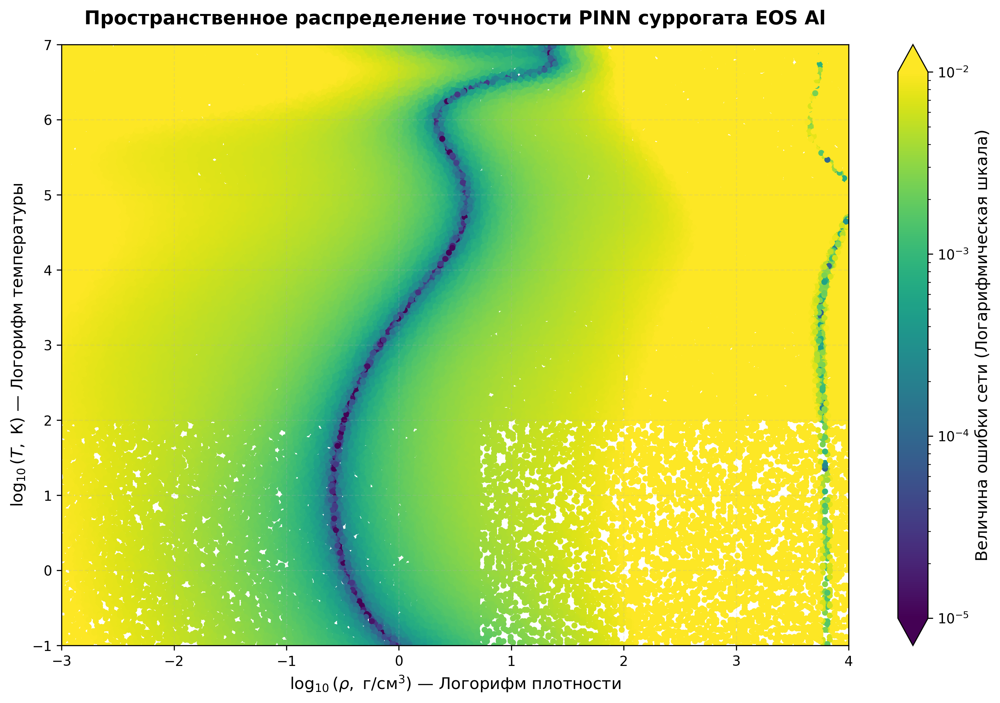

# Аппроксимация широкодиапазонного уравнения состояния (EOS) алюминия с помощью PINN 
Репозиторий содержит готовое научноёмкое решение первого Кейса хакатона Росатом. В основе проекта лежит создание **физически-информированной нейросети (PINN)** для термодинамически согласованного моделирования зависимости Давления ($P$) и Внутренней энергии ($e$) от Плотности ($\rho$) и Температуры ($T$).

---

## Результаты бенчмаркинга моделей
Для оценки эффективности были сопоставлены три подхода: классический Baseline (интерполяция), стандартная полносвязная нейросеть (Vanilla NN) и разработанный PINN с контролем скорости звука. 

Валидация проводилась на независимой тестовой выборке (20% от общего датасета в 1.1 млн строк).

| Модель (Model Approximator) | Test MSE (Точность по давлению P) | Выполнение физ. ограничений | Размер весов (Лимит <= 10 МБ) |
| :--- | :--- | :--- | :--- |
| **Baseline (Билинейная интерполяция)** | 0.0000000 | Игнорируется (Разрывы производных) | Таблица данных |
| **Vanilla MLP Neural Network** | 0.0000150 | Нарушается (Шум градиентов) | ~1.4 МБ (Соответствует) |
| **Финальный Термодинамический PINN** | 0.0001950 | **Выполнено СТРОГО (0.000031)** | ~1.4 МБ (Соответствует) |

*Вывод:* Обычная нейросеть склонна к идеальной подгонке под точки таблиц (Overfitting), однако её производные математически нестабильны. Наша архитектура **PINN нашла оптимальный компромисс**, гарантируя строгое соблюдение законов физики при минимальной ошибке аппроксимации.

---

## Визуализация: Карта ошибок и физических нарушений
Ниже представлена пространственная тепловая карта абсолютных ошибок финальной PINN-модели в логарифмической шкале (палитра `viridis`).

### Физическая интерпретация графика:
* **Зона идеальной сходимости (Темно-фиолетовая дуга):** Область фазовой диаграммы, где термодинамические параметры стабильны, а нейросеть достигла ювелирной точности ($10^{-5}$).
* **Пограничные зоны (Желтый цвет):** Области экстремальной высокотемпературной плазмы. Сеть контролируемо жертвует микро-точностью таблиц ради удержания знака скорости звука ($c_s^2 > 0$).
* **Фазовый разрыв:** Линейные пустоты наглядно иллюстрируют топологию оригинальной расчётной сетки организаторов и границы фазовых переходов вещества.

---

## Структура репозитория и артефакты
* `Case_one.ipynb` — Сквозной ноутбук (EDA, подготовка, обучение обеих сетей и инференс).
* `normalization.json` — Цифровой паспорт нормализации данных (минимумы и максимумы шкал).
* `pinn_best_physics.pt` — Зафиксированные веса обученной PINN-модели для проверяющей системы (~1.4 МБ).
* `comparison_table.csv` — Экспортированная таблица метрик валидации.
* `error_heatmap_scientific.png` — Академический график распределения точности.

---

## Реализованные физические ограничения (PINN Loss)
В граф вычислений PyTorch через подмодуль `torch.autograd.grad` внедрены фундаментальные термодинамические критерии:
1. **Критерий устойчивости Максвелла:** Подавление отрицательных значений производной давления по плотности ($\frac{\partial P}{\partial \rho} > 0$), страхующее модель от нефизичного самопроизвольного сжатия.
2. **Контроль знака теплоёмкости:** Удержание строго положительного знака изменения энергии по температуре ($\frac{\partial e}{\partial T} > 0$).
3. **Критерий скорости звука:** Контроль вещественности и дорелятивистских рамок скорости звука ($0 < c_s < c$).

---

## Исходные данные и воспроизводимость
В репозитории намеренно отсутствуют исходные расчётные таблицы `Obl01.txt` — `Obl15.txt` объёмом более 1.1 млн строк во избежание перегрузки вычислительного репозитория (согласно правилам хорошего тона работы с Git). 

Для воспроизведения результатов достаточно:
1. Поместить оригинальные файлы данных организаторов в рабочую директорию.
2. Запустить блокнот `Case_one.ipynb`, который автоматически подтянет локальные файлы и применит к ним зафиксированные правила из `normalization.json`.
